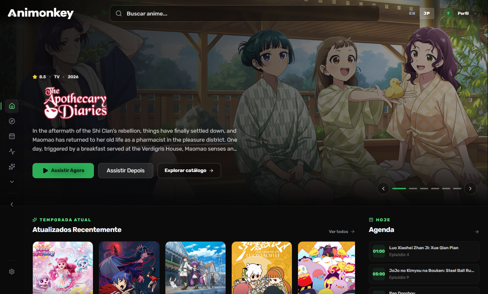

<div align="center">
  

  <p>Discover anime, manage your personal library, and watch episodes from available sources.</p>

  <p>
    <a href="README.pt-BR.md">Português (Brasil)</a> ·
    <a href="https://github.com/DaniHRE/animonkey-electron">GitHub repository</a>
  </p>

  <p>
    
    
    
    
    <a href="LICENSE"></a>
  </p>
</div>

Animonkey Desktop brings anime discovery and personal watch tracking into a desktop app. Explore the AniList catalog and schedule, keep your library on this device, and use the bundled Anivexa runtime to find episode sources supported by Vidstack.

> **Release status:** Version 1.0 is in preparation. Windows x64 is the initial distribution target; there is no public installer yet. Support for other release platforms has not been confirmed.

## Home



## What you can do

- **Discover anime:** Browse seasonal titles, search with catalog filters, check the schedule, and open anime details backed by AniList metadata.
- **Manage a personal library:** Keep your watchlist, ratings, and episode progress locally. These features work without an account and remain available offline.
- **Back up your data:** Import and export a versioned local backup.
- **Sync optionally:** Sign in to sync supported library data and use the activity feed.
- **Watch available episodes:** Get episode and provider listings from Anivexa and play supported sources with Vidstack.

Playback depends on the episode, provider, and stream currently available. The app does not host anime or guarantee that a particular source, audio track, or caption will be available.

## Technology

- **Desktop and build:** Electron Forge, Vite, React 19, and TypeScript 6
- **Interface:** Tailwind CSS 4, shadcn/Radix, TanStack Router, and TanStack Query
- **Playback:** Vidstack, HLS.js, and dash.js
- **Package manager:** pnpm 10
- **Catalog:** AniList; episode-source integration through the pinned Anivexa API submodule

## Run from source

There is no public installer yet. To start the development app, install [Node.js 26.x](https://nodejs.org/) and pnpm 10.33.3, then run:

```sh
pnpm install
pnpm start
```

Account and sync features are optional. They require the desktop API settings described in [`.env.example`](.env.example). Use only the publishable client key in the desktop app; never add server secrets such as a Supabase `service_role` key.

To create a Windows x64 package locally:

```sh
pnpm make --platform=win32 --arch=x64
```

The package prepares the pinned [`vendor/anivexa-api`](vendor/anivexa-api) submodule as a local Electron utility process. Episode and provider requests use typed IPC between the renderer and the main process.

## Documentation

- [Documentation index](docs/README.md)
- [1.0 release roadmap](docs/releases/1.0-roadmap.md)
- [Active 1.0 release checklist](docs/releases/1.0-checklist.md)
- [Archived migration plan](docs/archive/MIGRATION_PLAN.md)
- [Contributing guide](CONTRIBUTING.md)

## Credits and inspiration

- Thanks to [JulioC090](https://github.com/JulioC090) for the [Accendo Electron React App Template](https://github.com/JulioC090/accendo-templates/tree/main/accendo-electron-react-app-template), which made it much easier and faster to get this project started.
- [AniList](https://anilist.co/) supplies catalog metadata and schedule data.
- [Anivexa API](https://github.com/DaniHRE/Anivexa-API) supplies episode and provider integration through the pinned submodule in this repository.
- [Taizen](https://taizen.moe/) can enrich featured titles with artwork.
- [Vidstack](https://vidstack.io/) provides the media-player framework and caption interfaces.
- The watch-page information hierarchy draws inspiration from [Re:ANIME](https://reanime.cz/). The Animonkey desktop interface and styling are independently implemented.

## License

This repository is licensed under the [MIT License](LICENSE). Third-party projects, artwork, and APIs retain their own licenses and terms.
